# 🚗 Automobile Sales & Logistics Analytics

**End-to-end commercial analytics: SQL Server medallion model → tested Python analytics → Power BI (PBIP) → Streamlit app**

**Author:** Hardeep Bamrah · **Focus:** Commercial / BI / Data Analyst · **Stack:** SQL Server · Python (pandas, scikit-learn, statsmodels) · Power BI (TMDL / PBIR) · Streamlit · GitHub Actions


---

## The business question

A distributor of scale-model vehicles sells to 89 trade customers in 19 countries. Leadership wants to know:

1. **How healthy is fulfilment, and how much revenue is exposed?**
2. **Which markets and product lines carry the risk?** (and is that risk statistically meaningful?)
3. **Which customers matter most, and who is slipping away?**
4. **What actually drives customer revenue? Do fulfilment problems cost money?**

Data: 2,747 order lines · 298 orders · Jan 2018 – May 2020 (2020 is partial). Public Kaggle dataset, see [data dictionary](docs/data_dictionary.md).

---

## Headline results

| KPI | Value | Definition |
|---|---|---|
| Revenue | **£9.76M** | Σ line sales |
| Orders / AOV | **298 / £32.8k** | |
| Fulfilment rate | **96.2%** | fulfilled ÷ closed orders |
| Failure rate | **2.35%** (7 orders) | cancelled + disputed ÷ orders |
| Revenue at risk | **£251k (2.6%)** | on-hold + disputed, still recoverable |
| Revenue lost | **£194k (2.0%)** | cancelled |

All KPI definitions are in [docs/kpi_definitions.md](docs/kpi_definitions.md). SQL, Python and Power BI share the same definitions, and CI checks that SQL and Python agree.

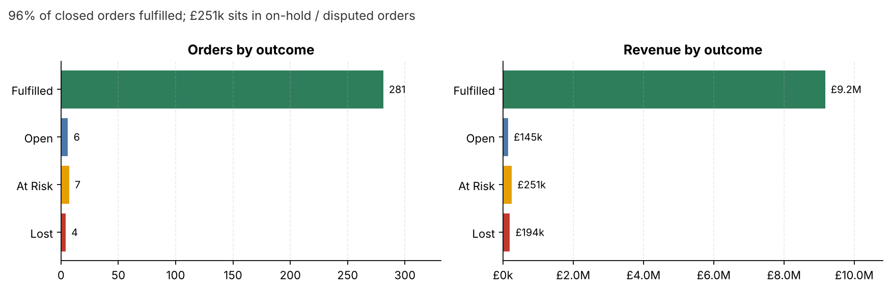

## Key insights

**Operations**
- Fulfilment is strong, but **£251k sits in 7 on-hold or disputed orders**. That's the most actionable number: it can still be recovered. All disputed orders date from April–May 2020, so they're unresolved, not historic.
- **Strong Q4 seasonality**: November is about 3.1× an average month in both full years. Like-for-like Jan–May revenue grew **+57% (2019)** and **+35% (2020)**.

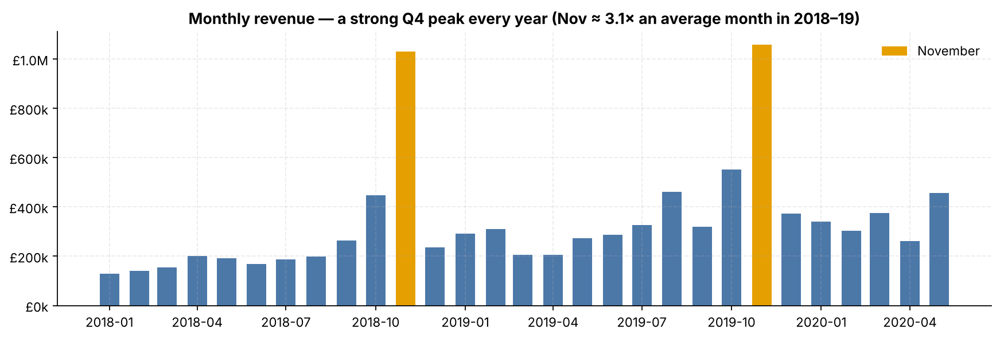

**Markets** — read the denominators
- Sweden and Denmark top the failure ranking (14.3%), but each is **1 failed order out of 7**. 14 of 19 countries have fewer than 10 orders and are flagged rather than ranked.
- Among markets with real volume, **UK (1/13)** and **Spain (2/36)** are the ones to watch. USA, the largest market (34% of revenue), failed 1 order in 103.

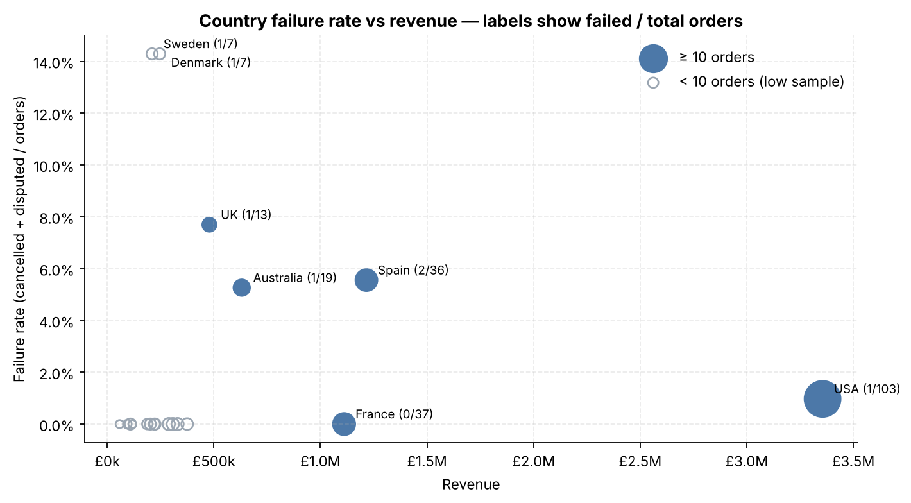

**Product lines**
- Classic Cars = **39%** of revenue. Ships has the highest *lost* share (**8.1%** of its revenue cancelled).
- Price realisation: Classic Cars sells about 4% *below* MSRP overall, while every other line averages *above* list price. That's a pricing conversation, not a fulfilment one.

**Customers**
- **High-value customers (RFM): 25% of the base → 46% of revenue.**
- **13 high-value customers have gone quiet** ("At Risk – High Value", £1.52M historic revenue). That's the win-back list.
- Concentration: the top 2 accounts hold **16%** of revenue and the top 10 hold **30%**.

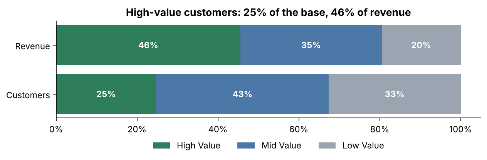

**Revenue drivers** (stated carefully)
- Revenue grows **in proportion to order count** (elasticity 1.06, 95% CI 0.82–1.31), and order value is similar across customers. **Growth comes from order frequency, not basket size.**
- **No evidence that fulfilment issues reduce customer revenue** (p = 0.68). But only 10 of 89 customers were affected, so the test has low power: absence of evidence isn't evidence of absence.

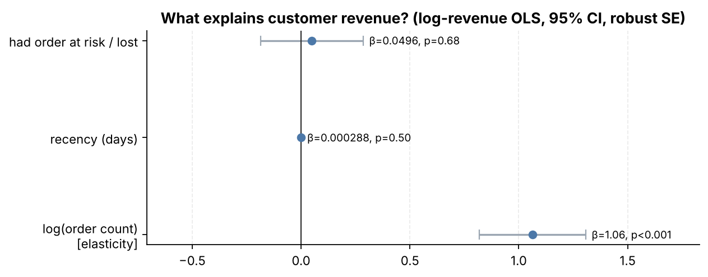

---

## Architecture

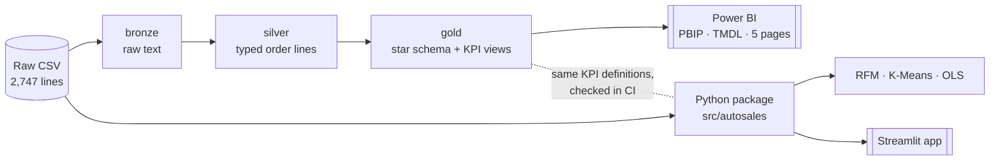

| Layer | What | Where |
|---|---|---|
| SQL | Bronze → Silver → Gold, star schema, 11 analysis queries, **24 data-quality tests** | [`sql/`](sql/README.md) |
| Python | Tested package: cleaning, KPIs, RFM, clustering, regression; reproducible pipeline | `src/autosales`, `scripts/run_pipeline.py` |
| Notebooks | Narrative analysis (executed, relative paths) | `notebooks/01–04` |
| Power BI | PBIP project: star-schema TMDL model, 32 documented measures, 5 report pages | [`powerbi/`](powerbi/README.md) |
| App | 6-tab Streamlit dashboard with filters | `app.py` |
| Quality | 27 pytest tests (Python, SQL-in-DuckDB, app smoke tests) + ruff, on every push | `tests/`, `.github/workflows/ci.yml` |

---

## Power BI report (PBIP, refreshed from SQL Server)

Five pages on a star-schema model: one fact table at order-line grain plus date, customer, product, country and status dimensions, with 32 documented measures. Opened, refreshed and checked in Power BI Desktop. Every card matches the SQL and Python numbers exactly. Details: [`powerbi/README.md`](powerbi/README.md).

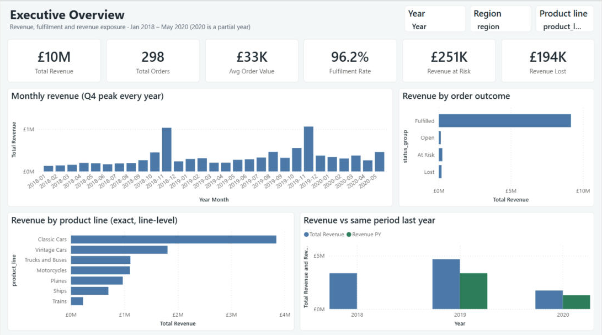

<p float="left">
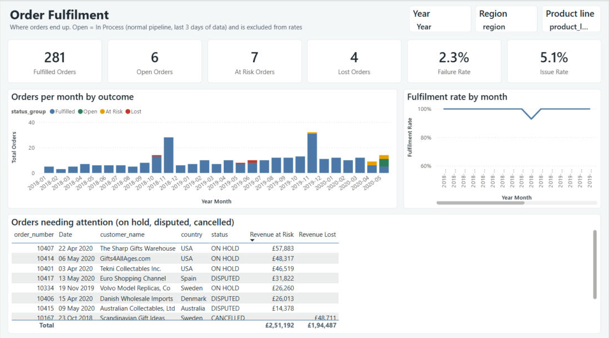
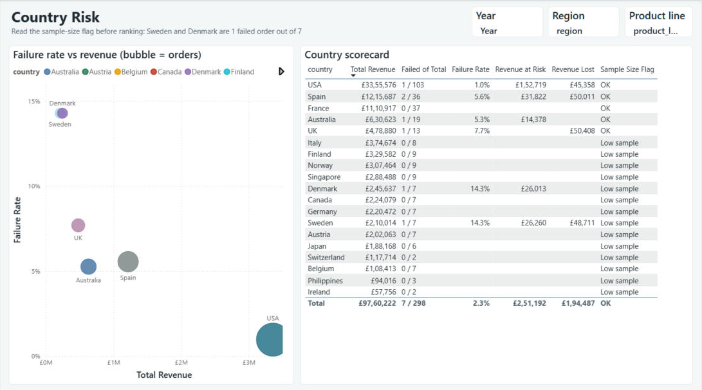
</p>
<p float="left">
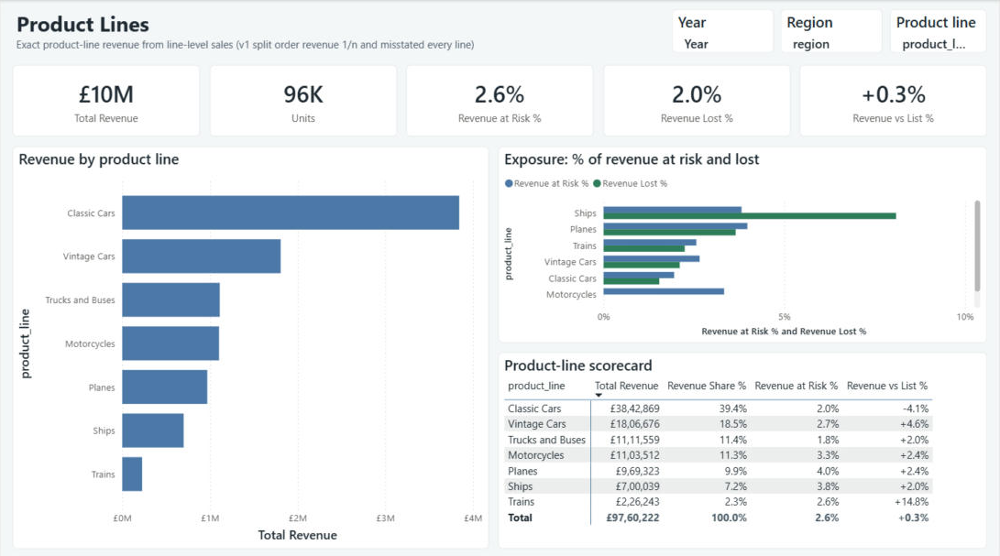
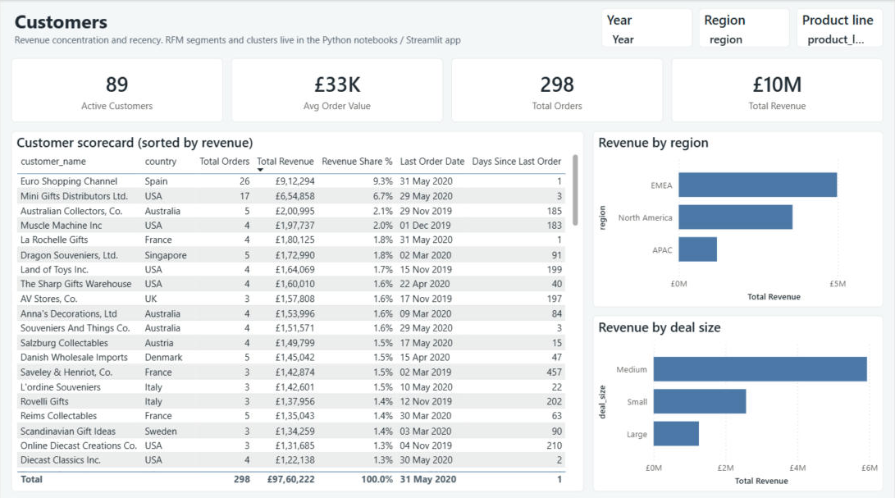
</p>

<sub>Screenshots were taken on a PC with English (India) regional settings, so large numbers use lakh grouping (£97,60,222 = £9,760,222). The model culture is en-GB.</sub>

---

## Streamlit app (runs locally)

A 6-tab dashboard with Year / Region / Product-line filters: Overview · Fulfilment · Country risk · Product lines · Customers · Methodology. It uses the same tested KPI code as the pipeline, so its numbers match SQL and Power BI. Run it with `streamlit run app.py` (see [Run it](#run-it)) and open http://localhost:8501.

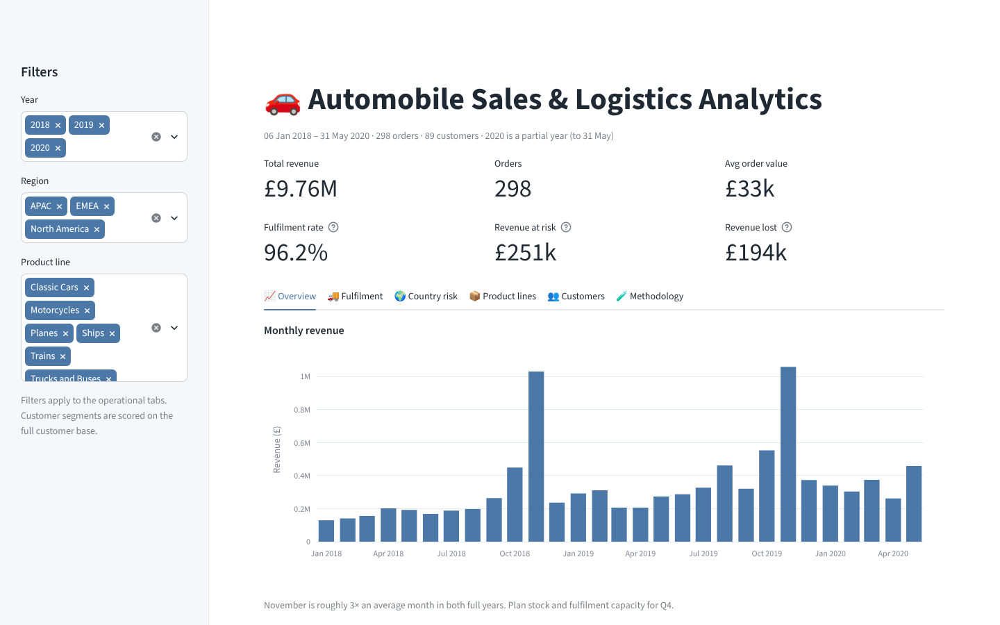

<p float="left">
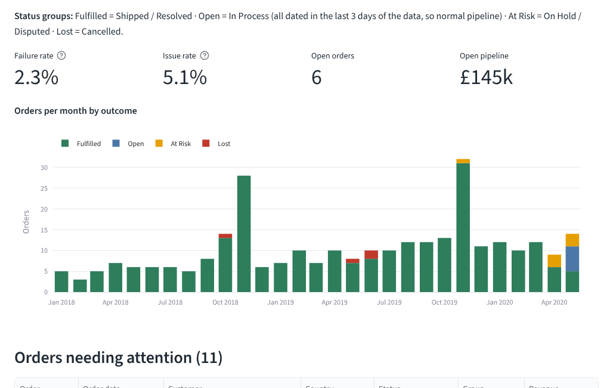
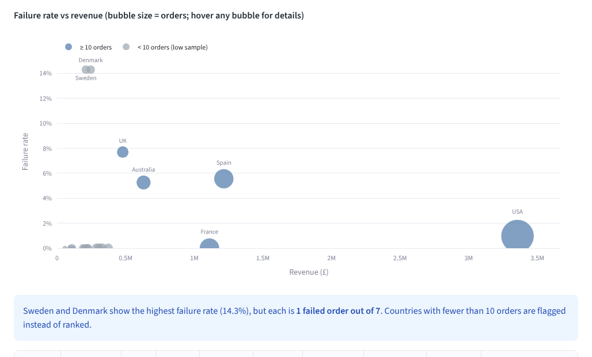
</p>

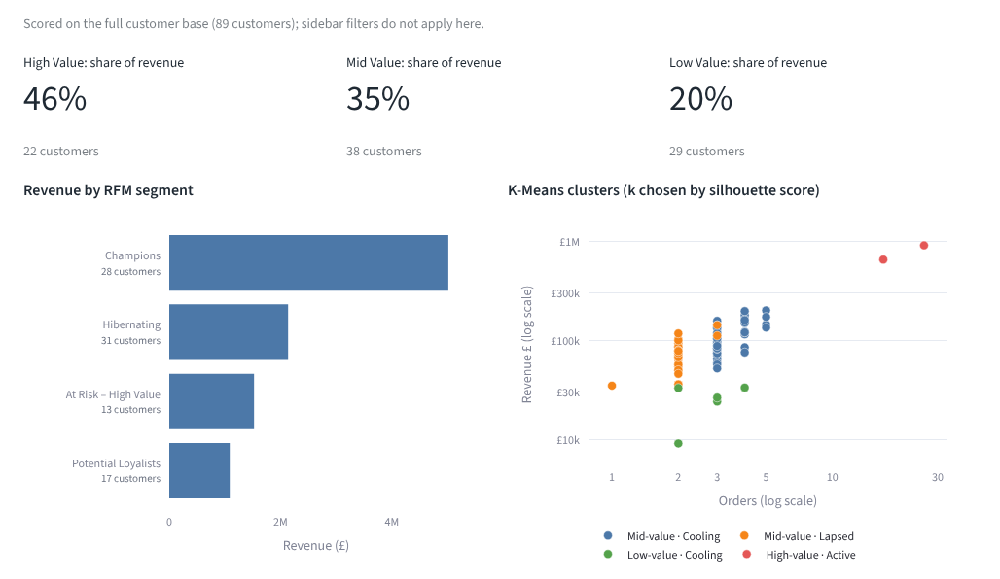

---

## v2: what an audit of v1 found and fixed

v1 of this project shipped with several analytical errors. Finding and fixing them was the most valuable part of the work. Full log: [docs/audit_v1_to_v2.md](docs/audit_v1_to_v2.md).

| Area | v1 | v2 |
|---|---|---|
| RFM | F and M scores **inverted**: the top customer was "Low Value" | Fixed and unit-tested. High tier now averages £202k (was £62k) |
| Product lines | Order revenue split **1/n** across lines (Trains +138%, Planes −25%) | Exact line-level sales. Revenue reconciles at every layer |
| Revenue at risk | £590k, incl. normal *in-process* orders and already-cancelled revenue | **£251k** at risk + **£194k** lost, reported separately |
| Clusters | k = 4 unjustified; the most active cluster labelled "Dormant" | k chosen by silhouette; labels generated from the data |
| Regression | R² = 0.971 on 18 test customers (mostly arithmetic) | log-log OLS, robust CIs, 100-fit cross-validation |
| Power BI | Date table **disconnected** (slicers did nothing), auto date/time, bidirectional bridge | Star schema in PBIP/TMDL, marked date table, parameterised source |
| App | Crashed on Linux (`data` vs `Data`; Windows-only dependency) | Fixed, 6 tabs, smoke-tested in CI |

<p float="left">
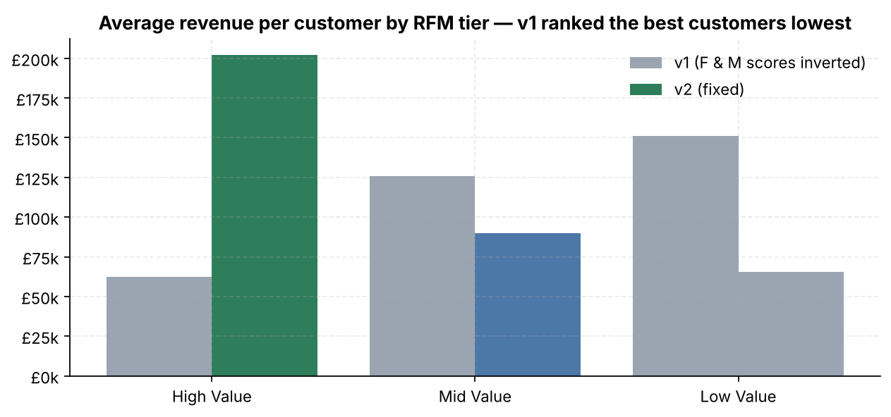
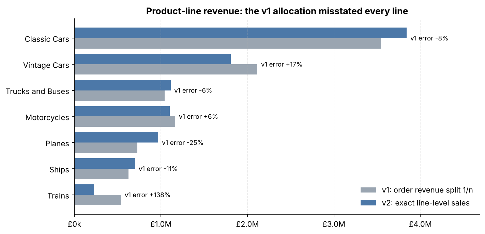
</p>

Unchanged between versions: revenue £9,760,221.71, 298 orders and the 2.35% failure rate. That confirms the raw data was read correctly in both.

---

## Run it

```bash
git clone https://github.com/hardeep282/Automobile-Sales-Logistics.git
cd Automobile-Sales-Logistics
python -m venv .venv && .venv\Scripts\activate        # macOS/Linux: source .venv/bin/activate
pip install -r requirements-dev.txt

python scripts/run_pipeline.py      # rebuild data/processed + reports/figures
pytest -q                           # 27 tests
streamlit run app.py                # dashboard on http://localhost:8501
```

- **SQL Server:** `powershell -ExecutionPolicy Bypass -File scripts\run_sql_pipeline.ps1` builds bronze → silver → gold and runs the 24 tests in one go (or run `sql/00` → `05` in SSMS). See [`sql/README.md`](sql/README.md).
- **Power BI:** open `powerbi/Automobile_Sales_Logistics.pbip`, set the `ServerName` parameter, then refresh. See [`powerbi/README.md`](powerbi/README.md).

## Repository structure

```
├── app.py                      Streamlit dashboard
├── data/raw/                   source CSV (never modified)
├── data/processed/             pipeline outputs used by the app
├── sql/                        00–05 medallion scripts + tests
├── src/autosales/              tested analytics package
├── scripts/run_pipeline.py     one command to rebuild everything
├── notebooks/                  01 audit & KPIs · 02 RFM · 03 clustering · 04 revenue drivers
├── powerbi/                    PBIP project (TMDL model + PBIR report)
├── reports/figures/            charts used in this README
├── docs/                       KPI definitions · data dictionary · v1→v2 audit · Power BI (v2 + v1 'before') and Streamlit screenshots
└── tests/                      pytest: pipeline, SQL-in-DuckDB, app
```

## Skills demonstrated

SQL data modelling (medallion, star schema, window functions, recursive CTEs, data tests) · KPI design and governance · Power BI semantic modelling (TMDL, DAX time intelligence, PBIR) · customer segmentation (RFM, K-Means with model selection) · statistical inference (robust OLS, cross-validation, power) · reproducible analytics (packaging, CI, tests) · auditing and correcting analytical errors · business storytelling

## License

MIT, see [LICENSE](LICENSE).
