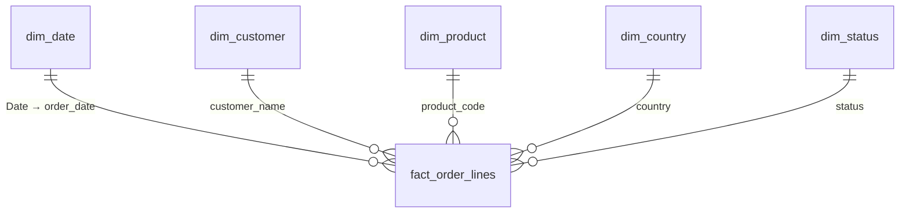

# Power BI: PBIP project (v2)

The report is stored as a **Power BI Project (PBIP)**: the semantic model is plain-text **TMDL** and the report is **PBIR** JSON. That means every measure, relationship and visual shows up as a readable diff in git, which a `.pbix` binary can't do.

```
powerbi/
├── Automobile_Sales_Logistics.pbip               ← open this in Power BI Desktop
├── Automobile_Sales_Logistics.SemanticModel/
│   ├── definition.pbism
│   └── definition/
│       ├── database.tmdl  model.tmdl  expressions.tmdl (parameters)  relationships.tmdl
│       └── tables/  fact_order_lines · dim_date · dim_customer · dim_product · dim_country · dim_status · _Measures
└── Automobile_Sales_Logistics.Report/
    ├── definition.pbir   (bound to ../Automobile_Sales_Logistics.SemanticModel)
    ├── definition/       report.json · pages/<page>/page.json · visuals/<visual>/visual.json
    └── StaticResources/  base theme + AutosalesTheme.json
```

## Open and refresh

1. Run `sql/00` → `sql/03` on your SQL Server instance (then `sql/05` should show every test as PASS).
2. Open `Automobile_Sales_Logistics.pbip` in Power BI Desktop (March 2025 or later).
3. If your server isn't `.\SQLEXPRESS`: **Transform data → Edit parameters**, then set `ServerName` (and `DatabaseName`).
4. Click **Refresh**. On first refresh Desktop may ask about credentials: choose *Windows* / *Use my current credentials*.
5. Check the numbers against the table below, then **File → Save** (the project stays as PBIP).

| Check (no filters) | Expected |
|---|---|
| Total Revenue | £9,760,222 |
| Total Orders | 298 |
| Fulfilment Rate | 96.2% |
| Failure Rate | 2.3% |
| Revenue at Risk | £251,192 |
| Revenue Lost | £194,487 |
| Classic Cars revenue | £3,842,869 |

> Requirement: **File → Options → Preview features → "Store reports using enhanced metadata format (PBIR)"** and **"Power BI Project (.pbip) save option"** must be on. Your original PBIX was already saved in PBIR, so they probably are.

## Model (star schema)



- **One fact at order-line grain.** Product-line revenue is just `[Total Revenue]` sliced by `dim_product[product_line]`, so it's exact. The v1 bridge table and its 1/n allocation are gone.
- **All relationships are many-to-one and single-direction.** v1 had a bidirectional relationship and used an aggregated KPI table as the country dimension.
- **`dim_date` is a calculated table marked as the date table**, related to the fact. In v1 the date table wasn't related to anything, so every YearMonth slicer did nothing and YTD/MoM/YoY returned the overall total.
- **Auto date/time is off** (`__PBI_TimeIntelligenceEnabled = 0`). v1 carried three hidden auto date tables.
- **Implicit measures are discouraged**, so every number on the report comes from a documented measure.
- **The source is parameterised** (`ServerName`, `DatabaseName`) instead of hard-coding `.\SQLEXPRESS` in each query.
- **Personal data (phone, address) isn't imported.**

## Measures (`_Measures`, in display folders)

| Folder | Measures |
|---|---|
| 1. Revenue | Total Revenue · Total Orders · Order Lines · Units · Avg Order Value · Active Customers · Revenue Share % · Revenue vs List % |
| 2. Fulfilment | Fulfilled / Open / At Risk / Lost / Failed Orders · Orders With Issue · Closed Orders · **Fulfilment Rate** · Issue Rate · **Failure Rate** · Failed of Total · Sample Size Flag |
| 3. Revenue Risk | **Revenue at Risk** · Revenue at Risk % · **Revenue Lost** · Revenue Lost % · Open Pipeline Revenue |
| 4. Time Intelligence | Revenue YTD · Revenue PY (like-for-like, limited to dates with data) · Revenue YoY % · Revenue PM · Revenue MoM % |
| 5. Customers | Last Order Date · Days Since Last Order |

Each measure has a description (hover over it in the field list). The definitions match `sql/03_gold_model.sql` and `src/autosales/kpis.py`; see `docs/kpi_definitions.md`.

## Report pages

1. **Executive Overview**: 6 KPI cards, monthly revenue, revenue by outcome, by product line, and vs the same period last year.
2. **Order Fulfilment**: orders per month by outcome, fulfilment-rate trend, and a list of the orders that need attention.
3. **Country Risk**: failure rate against revenue, plus a scorecard showing *failed / total* and a sample-size flag.
4. **Product Lines**: exact revenue, % at risk and % lost, and price realisation against MSRP.
5. **Customers**: customer scorecard (revenue share, recency), revenue by region and by deal size.

Every page has Year / Region / Product line slicers.

## Validation

- **Opened, refreshed and saved in Power BI Desktop (Nov 2026)** against SQL Server Express with no errors. The files in this folder are Desktop's own serialisation (lineage tags, `diagramLayout.json`).
- Every headline number was checked with DAX queries against the open model and matches SQL and Python to the penny: £9,760,221.71 · 298 orders · fulfilment 96.2% · at risk £251,192.05 · lost £194,487.48 · Trains £226,243.47 · 2020 vs Jan–May 2019 +34.7%.
- The PBIR / PBIP JSON validates against Microsoft's published schemas (`github.com/microsoft/json-schemas`). One visual uses `visualContainer/2.14.0`, which Desktop writes but Microsoft hasn't published yet.
- Every column, measure, sort-by column and relationship referenced in TMDL and the report resolves to an object in the model, and the `sourceColumn`s match the `gold.*` views.

> Numbers in the screenshots use Indian digit grouping (e.g. £97,60,222) because they were taken on a PC with English (India) regional settings. The model culture is en-GB, so a UK machine or Power BI Service shows £9,760,222.

**Industry equivalent:** PBIP + TMDL in git, with deployment pipelines / Fabric Git integration. Tabular Editor and the Best Practice Analyzer are often used to lint the model.
