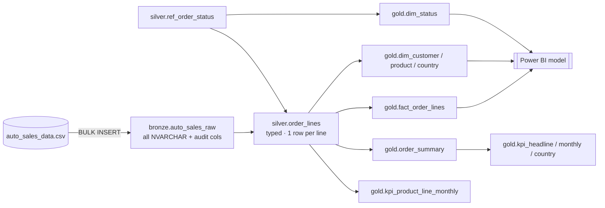

# SQL layer (SQL Server, medallion architecture)

Run in order in SSMS or Azure Data Studio, connected to your instance (e.g. `.\SQLEXPRESS`):

| Script | Creates | Notes |
|---|---|---|
| `00_setup_database.sql` | `autosales_DB`, schemas `bronze` / `silver` / `gold` | idempotent |
| `01_bronze_load.sql` | `bronze.auto_sales_raw` | **edit `@csv_path`** first. Option B reuses a table loaded by the SSMS import wizard |
| `02_silver_transform.sql` | `silver.ref_order_status`, `silver.order_lines` | typing, trimming, status mapping, PII dropped |
| `03_gold_model.sql` | star schema (`fact_order_lines`, `dim_*`) + `order_summary` + `kpi_*` views | what Power BI imports |
| `04_kpi_analysis.sql` | read-only | 11 business questions with expected answers |
| `05_data_quality_tests.sql` | read-only | 23 tests. Every row should say **PASS** |

**Design choices**
- Bronze stores everything as text, so a bad value never breaks the load. Typing happens in silver with `TRY_CONVERT`, and test 05 catches anything that turned into NULL.
- The status business logic lives in **one** reference view (`silver.ref_order_status`), so no view can drift from it.
- Every object is a view created with `CREATE OR ALTER` in dependency order, so the scripts are safe to re-run. At production scale you'd materialise silver/gold as tables, with incremental loads.
- Personal data (phone, address, postcode) stops at bronze.

**How it's tested without SQL Server:** `tests/test_sql_layer.py` translates each batch from T-SQL to DuckDB with `sqlglot`, runs silver → gold → the 23 data-quality tests on the raw CSV, and checks the results against the Python pipeline. This runs on every push (GitHub Actions).

**Industry equivalent:** dbt (staging → marts, seeds, tests) on Snowflake / BigQuery / Fabric Warehouse, with ingestion by Fivetran / ADF.
